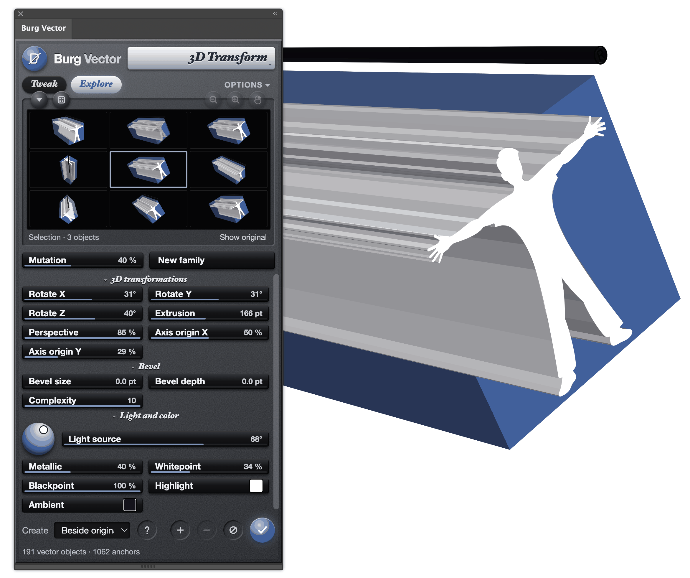
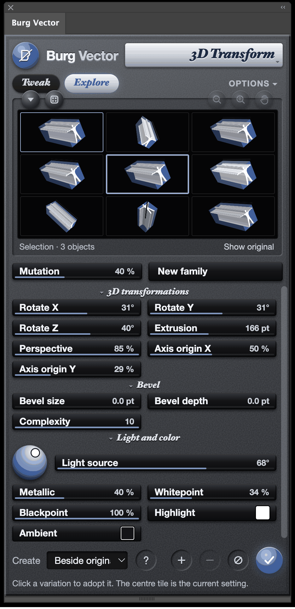
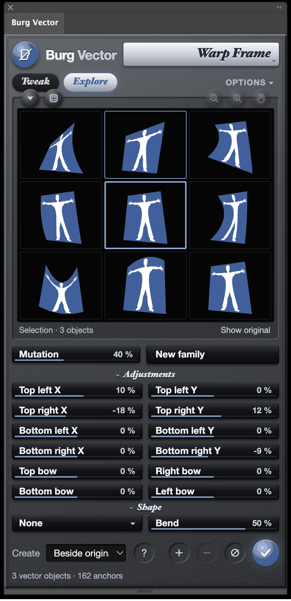
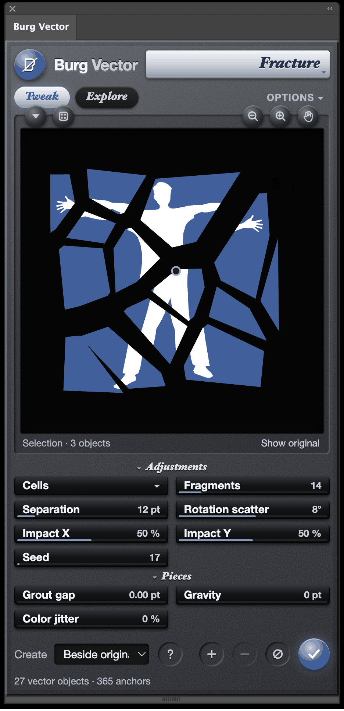
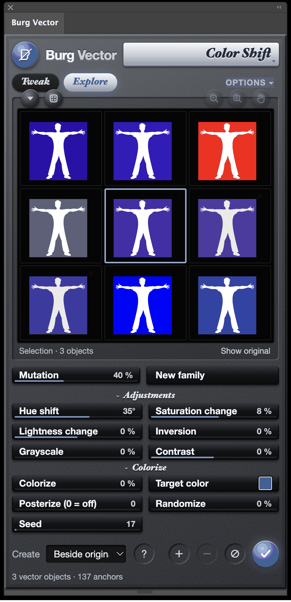
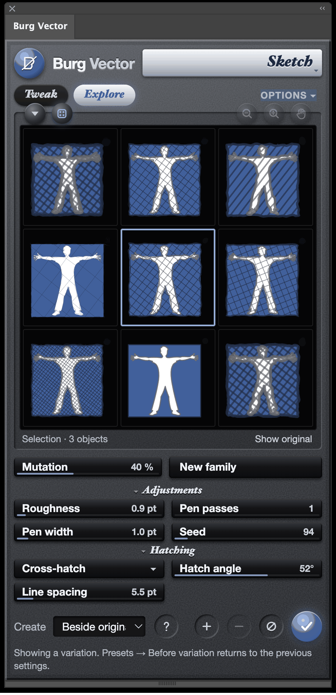
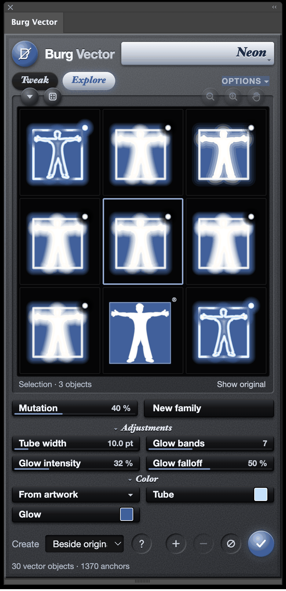

# Burg Vector

An Illustrator panel with thirteen vector effects — extrude, warp, fracture, inset, sketch, glow and more — whose results are always plain, editable paths. A homage to **KPT Vector Effects**, Kai Krause’s plug-ins that once turned Illustrator into a playground.

Select artwork and the panel previews it live. Drag across a control, move the light on its sphere, let **Explore** breed variations, then press **✓** to create the artwork. Nothing is a live effect or a raster: the result is a group of ordinary paths you can recolour, ungroup and keep editing. Below, the panel is in Explore mode beside the finished extrusion. The blue block and white figure were extruded together; the long ridges are the side walls of the figure itself.



**Status: in use on macOS.** All thirteen effects are tested end to end in Illustrator 30.8.2: each result is written into a real document, read back and compared anchor by anchor and handle by handle. The Windows installer is built but has not yet been tried with Illustrator on Windows. Free and open source under the [MIT License](LICENSE).

[Install Burg Vector](#installation) · [Try the pictured extrusion](#try-the-pictured-extrusion) · [Screenshot gallery](#one-figure-six-effects) · [All 13 effects](#effect-guide) · [Why this exists](#why-this-exists)

## Installation

Version **0.3.1** targets desktop Illustrator **2026 (30.x)** and Adobe’s CEP 12 panel runtime. The signed extension is [Burg Vector.zxp](Burg%20Vector.zxp). For macOS, choose **Code → Download ZIP** on the repository home page and extract the archive. For Windows, use the installer ZIP below.

| Platform | Status |
| --- | --- |
| macOS | Installed and tested in Illustrator 30.8.2, including all thirteen effects and a 3,600 pt extrusion. |
| Windows x64 (Intel or AMD) | The installer was exercised on Windows with simulated Adobe installer responses. End-to-end installation and effects in Illustrator on Windows still need verification. |

### macOS

1. Open Creative Cloud Desktop and sign in.
2. In the extracted folder, double-click **Install Burg Vector.command**. Keep it next to **Burg Vector.zxp**. If macOS blocks it because the developer cannot be verified, open **System Settings → Privacy & Security**, click **Open Anyway** for the installer, and confirm.
3. After the installer reports success, restart Illustrator and choose **Window → Extensions → Burg Vector**.

### Windows x64

**[Download the Windows installer for Burg Vector 0.3.1 (ZIP)](https://github.com/tsevis/burg-vector/releases/download/v0.3.1/Burg-Vector-0.3.1-Windows.zip)**

1. Install Illustrator 2026 (30.x) and sign in to Creative Cloud Desktop.
2. Right-click the downloaded ZIP and choose **Extract All**. Open the extracted folder and double-click **Install Burg Vector.cmd**. Keep **Burg Vector.zxp** alongside it.
3. Wait for **Burg Vector 0.3.1 is installed**. Save your work, restart Illustrator, and choose **Window → Extensions → Burg Vector**.
4. Select a filled rectangle, choose **3D Transform**, and click **Create vector artwork**. A new group beside the rectangle confirms the panel can read and write artwork in Illustrator.

The installer calls Adobe’s Unified Plugin Installer Agent and checks that Creative Cloud lists the installed version. If it cannot find the Adobe installer, open or update Creative Cloud Desktop, sign in, and try again. If Adobe reports an error, its message stays in the installer window until you press a key. [Adobe’s installation instructions](https://helpx.adobe.com/creative-cloud/apps/integration-with-other-apps/manage-plugins/install-plugins-using-upia-tool.html)

To remove the extension, use **Manage plugins** in Creative Cloud Desktop. This build uses a self-signed development certificate.

## Try the pictured extrusion

1. Select a filled silhouette and its background together. The preview follows the selection automatically. For lettering, make an outlined copy first.
2. Choose **3D Transform**. The screenshot uses **Rotate X 31°**, **Y 31°**, **Z 40°**, **Extrusion 166 pt**, **Perspective 85%**, **Axis origin Y 29%**, **Complexity 10**, **Light source 68°**, **Metallic 40%**, **Whitepoint 34%** and **Blackpoint 100%**. For a longer extrusion, drag across **Extrusion** up to **3,600 pt**, or double-click it and type any whole-point depth. The control moves by 1 pt through 180 pt and by 20 pt beyond it.
3. Use **Show original** to compare. Choose **Beside original** and click **Create vector artwork** to place a new group 18 pt to the right, on the source layer. **Over original** uses the source coordinates and keeps the original artwork underneath.
4. Illustrator selects the new group. You can ungroup it to edit a face, apply a different effect to the whole result, or reselect the original to try another version.

## One figure, six effects

Each screenshot is the panel with the same three objects selected. Most are in **Explore** mode: the framed centre tile is the current setting and the eight around it are its variations. Click any screenshot to see it at full size.

| 3D Transform | Warp Frame |
| --- | --- |
| [](screenshots/explore-3d-transform.png) | [](screenshots/explore-warp-frame.png) |
| Explore breeds new angles, depths and perspectives from the extrusion above. Click a tile to adopt it and breed again. | Corner and bow settings mutate together, from gentle tapers to a figure swept sideways. |

| Fracture | Color Shift |
| --- | --- |
| [](screenshots/fracture.png) | [](screenshots/explore-color-shift.png) |
| **Cells** with 14 fragments, 12 pt separation and 8° rotation scatter. Grout gap, gravity and colour jitter sit under **Pieces**. | Hue, saturation and the new colorize, posterize and randomize settings, explored from one blue figure. |

| Sketch | Neon |
| --- | --- |
| [](screenshots/explore-sketch.png) | [](screenshots/explore-neon.png) |
| **Cross-hatch** at 52° and 5.5 pt spacing, clipped inside each shape, with one rough pen pass over the outlines. | Tube width, glow bands, intensity and falloff varied together, from a thin filament to a full bloom. |

## Effect guide

| Effect | What you can make |
| --- | --- |
| 3D Transform | Rotate about a movable axis origin, extrude, and add a chamfered or rounded bevel. Light it from the sphere, add a metallic finish, and pick the highlight and ambient colours, with whitepoint and blackpoint for how far they reach. The front, back, walls and bevel facets become editable vector faces. |
| Warp Frame | Taper a design with four corner handles and bow each edge. Then bend the whole frame into an Arc, Bulge, Wave, Flag or Twist. |
| Vector Distort | Apply Swirl, Spherize, Pinch, Rotate, Magnify, Zig, Zag, ZigZag, Ripple or Wobble around a movable center. Frequency sets how many waves, edge hardness how sharply the lens stops. |
| Fracture | Cut closed shapes into cells or radial fragments. Set the impact center, separation and rotation, open grout gaps, let the pieces fall with gravity, and jitter their colours. |
| Inset | Offset an outline inward or outward, including the holes in compound paths. Choose round, miter or bevel joins. Add steps for concentric rings that blend toward a colour. |
| Point Editor | Move an anchor or either Bézier handle, subdivide a segment, or switch a point between smooth and corner. |
| Simplify | Reduce anchor count. A lower curve tolerance keeps the result closer to the source contour; **Keep corners** protects sharp points from being smoothed away. |
| Sketch | Trace paths with repeatable, slightly irregular pen strokes. Control roughness, passes, width and seed, and fill shapes with hatching or cross-hatching clipped to their outline. |
| Color Shift | Change hue, saturation, lightness, contrast, inversion and grayscale for fills and strokes. Colorize toward one colour, posterize to a few levels, or randomise each object. |
| Emboss | Build a highlight and shadow along an edge. Set the relief depth, light angle, contrast and softness, and choose both colours. |
| Flare | Add a movable halo and rays, with lens rings strung across the artwork and a little ray jitter. Take the colour from the artwork or pick your own. |
| Neon | Build a bright tube and layered glow bands around a contour. Set how quickly the glow falls off, and choose custom tube and glow colours. |
| Shadow Echo | Echo repeats the silhouette along a direction, fading, scaling or rotating the copies. Cast lays a shadow on the ground from the base; Drop makes a soft offset shadow. Pick the shadow colour and tint. |

## The panel

Every control is a glossy pill that works as a slider, in the spirit of Kai Krause’s tools. **Click or drag along a pill** to set its value, hold **Shift** for fine steps from where it is, or double-click it to type a value. Drag the highlight on the sphere to move the light. Blue handles in the preview move centres, corners and the 3D axis origin.

The panel fits itself to its height. Spare room goes to the preview; in a short panel the preview shrinks first and then the settings scroll. Click a section heading, such as *Bevel*, to fold it away; each effect remembers its folded sections.

- **Tweak and Explore.** Tweak is for adjusting one setting at a time. Explore fills the preview with eight variations around the current settings; click one to adopt it and breed again from there. **Mutation** sets how adventurous the children are, and **New family** rolls another set.
- **Presets.** The ▾ button above the preview opens the presets, drawn as thumbnails of your own artwork. ⊕ adds the current settings under a name, ⊖ removes the selected one, and ⊘ returns to the defaults. The dice button previews a small variation; **Before variation** in the presets takes you back.
- **Zoom and hand.** Zoom into the preview, or turn on the hand to pan. Double-click the hand to fit the artwork again.
- **Options.** **Real-time preview** redraws while you drag; turn it off for very complex artwork so the preview waits until you let go. **Launch to previous state** reopens the last effect and settings. **Graphical presets** shows thumbnails instead of names, **Numeric display** keeps values visible on the controls, and **Large controls** makes them easier to hit with a pen or touch screen. The preview background can be black, white, gray, a checkerboard or any colour.

Settings and presets are kept on this computer only.

## Preparing artwork

- **Paths and color.** Select painted paths, compound paths or ordinary groups with solid RGB, CMYK or grayscale fills or strokes. Outline live type, expand brushes and complex appearances, and release clipping masks before selecting the artwork. Convert spot, gradient or pattern paint to solid colors where needed.
- **Closed shapes.** 3D Transform, Inset and Fracture need closed, filled paths. Inset and Fracture approximate curves with line segments when calculating offsets and intersections.
- **Complex selections.** Work in batches of up to 150 painted objects and 6,000 source anchors. If a result exceeds 1,800 objects or 40,000 anchors, or a single path exceeds Illustrator’s limit of 32,000 anchors, reduce the detail or select fewer objects.
- **Editing afterward.** Keep the original if you want to revisit settings. The result is an expanded group of Illustrator paths. A new selection immediately replaces the panel preview, and deselecting clears it.

## Why this exists

There was a time when creative software had a personality. Kai’s Power Tools, Bryce, Goo and their siblings did not hide their controls in dialogs; they put them on glowing spheres and odd little dials, and they made you want to play before you knew what you were making. KPT Vector Effects brought that spirit to Illustrator in the late 1990s: 3D extrusions, warps, shatters, glows and shadows, all still vector.

Those plug-ins stopped running long ago, but the feeling they gave never quite went away — the pleasure of nudging a slider, pressing a button for a random variation, and getting something you would not have drawn yourself. Burg Vector is written out of that nostalgia. It does not copy the old interface or reuse any of its code; it rebuilds the idea for today’s Illustrator, with one rule the old filters already followed: whatever you make stays editable vector artwork.

I have deep respect for Kai Krause and admire the way his tools invite artists to experiment. I still believe his work is as relevant today as ever, and I hope Burg Vector gives artists that same urge to try one more variation.

## Development

The panel runs offline. The [effect catalog](extension/catalog.js) defines the controls. [effects.js](extension/effects.js) and [path-effects.js](extension/path-effects.js) generate the geometry used for both the preview and the Illustrator result, so what you see is what gets written. The [host script](extension/host.jsx) checks the selection again before writing and removes a partially created group if a write fails.

From the repository directory, run the geometry checks with Node.js 20 or later:

```sh
node tools/check.mjs
```

On a Mac with Illustrator installed, `node tools/check.mjs --illustrator` also creates every effect in temporary Illustrator documents and checks the paths it reads back. To sign a new ZXP, set `ZXP_PASSWORD` for your signing identity, optionally set `ZXP_TSA` to a timestamp server, and run `tools/package.sh /path/to/ZXPSignCmd /path/to/identity.p12 output.zxp`.

## Credits and license

Burg Vector is an independent implementation inspired by KPT Vector Effects 1.5. Legacy preset files and Appearance-panel live effects are outside this version, and bevels and metallic finishes are flat-shaded facets rather than gradients. The original software and manual are not part of this repository. The project is unaffiliated with the original publishers, Corel or Adobe.

Released under the [MIT License](LICENSE). The extension includes the Clipper geometry library and its JSBN component under their own licenses. [Third-party notices](extension/vendor/LICENSES.txt)
